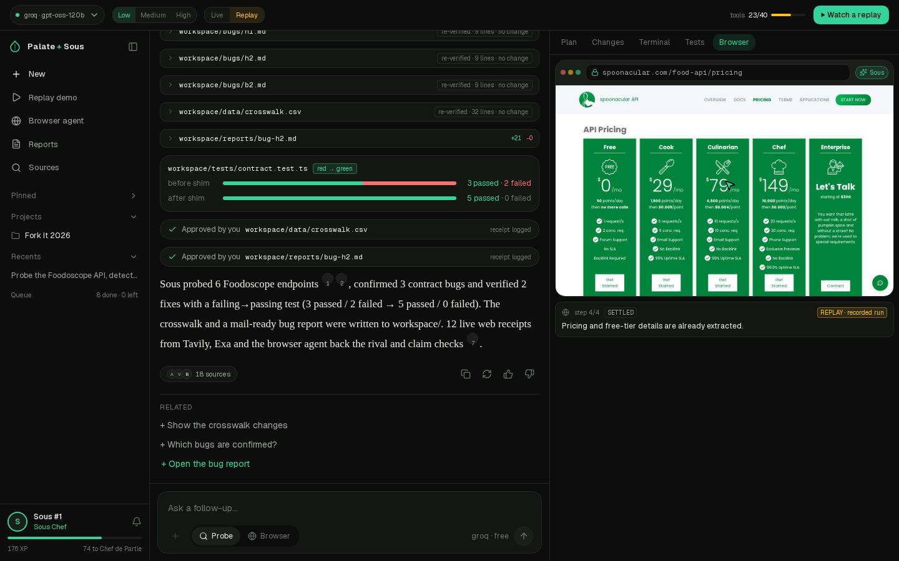
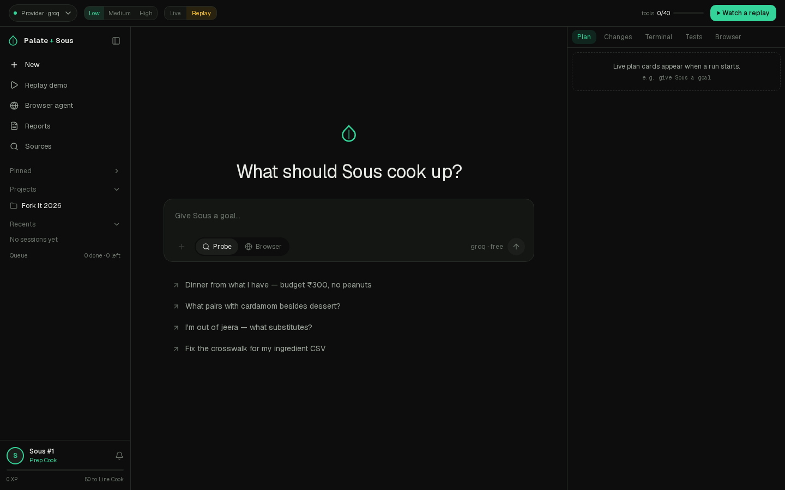
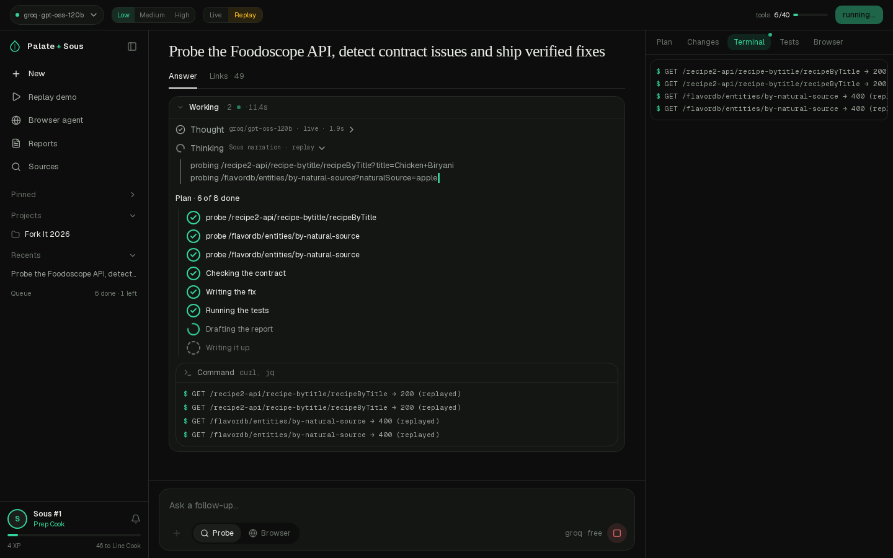
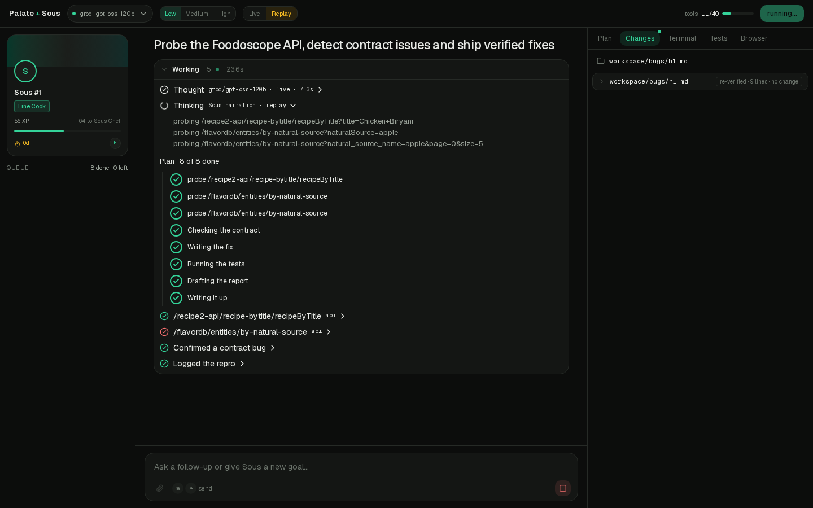
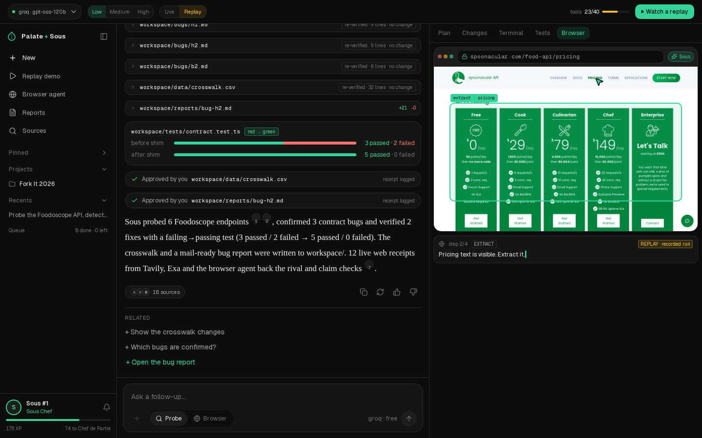
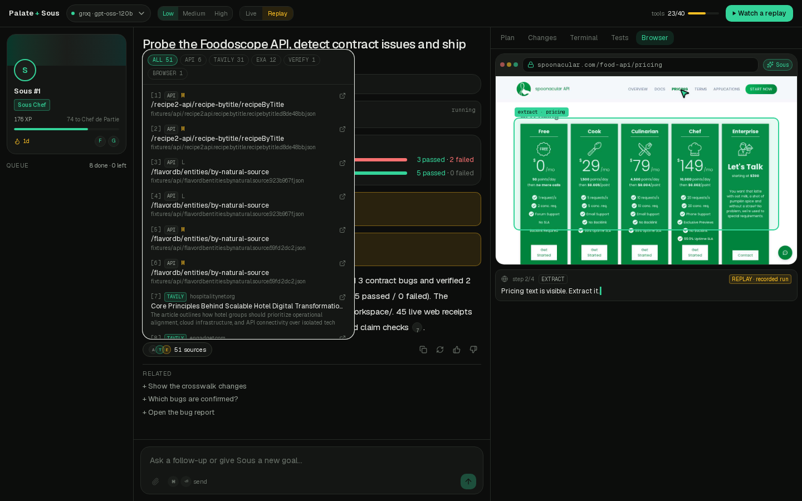
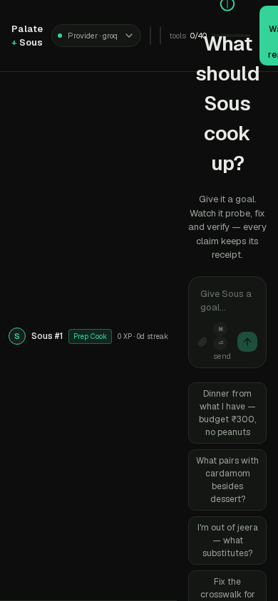
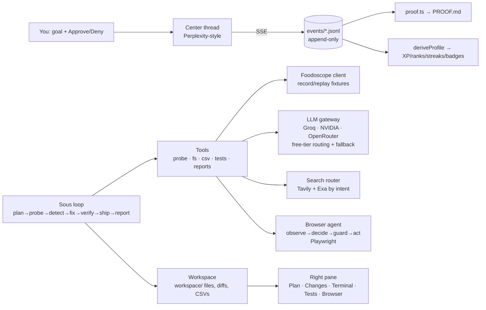

# Palate + Sous

**Sous** is an autonomous agent that probes the [Foodoscope](https://www.foodoscope.com/) APIs (RecipeDB2, FlavorDB), proves every contract gap with recorded evidence, ships verified fixes, and files mail-ready bug reports. **Palate** is the gamified profile layer on top — XP, ranks, streaks and badges, all computed from the same event log. Built for the Foodoscope Fork It Challenge 2026 (IIIT Delhi × CoSy Lab).

> Give it a goal. Watch it work. Every claim keeps its receipt.



---

## What it is

- **An agent you can watch.** Real model reasoning streams live, then a paced run: plan → probe → detect → fix → verify → ship → report. Every step shows the model, latency and tokens. Sponsor-facing writes pause for a human **Approve/Deny**.
- **An auditor with receipts.** No repro, no bug. No failing→passing test, no verified fix. Every number in the UI, README and `PROOF.md` traces to an append-only event or a committed fixture. Unmeasured values render `[measure]` — never estimates.
- **A game that is the proof.** Sous's own profile card (rank, XP, streak, badges) is derived from `events/*.jsonl`. Delete the profile, replay the log, get the identical card.

| Idle hero | Live run — thinking, plan, command card |
|---|---|
|  |  |

| Tests red→green + human approval gate | Comet-style browser agent (real screenshots, cursor) |
|---|---|
|  |  |

| Real sources with links (Tavily · Exa · browser) | Mobile |
|---|---|
|  |  |

## Live

**Deployed: https://foodoscope-six.vercel.app** — replay mode works with zero keys (the provider pill shows the honest "not connected" state; add keys in the Vercel dashboard to enable live thinking).

## Run it yourself (5 minutes)

**Replay first — no keys, no network needed:**

```bash
git clone https://github.com/abhyudaya874-ai/foodoscope-palate-sous.git
cd foodoscope-palate-sous
pnpm install
pnpm dev            # → http://localhost:3001
```

Click **▶ Watch a replay** (or any goal chip). The recorded run plays with realistic pacing: live model thinking → probes → the bug → the shim diff → the crosswalk → tests red→green → two approval pauses (click Approve) → the cited answer → the browser agent.

**Then the offline checks:**

```bash
pnpm test                      # 48 unit tests pass
pnpm proof && pnpm proof:check # regenerate PROOF.md from events; reject unsourced numbers
pnpm tsx scripts/run-intel.ts --replay   # rebuild rivals.csv + claims.csv from cached search evidence
```

**Live mode (optional):** copy `.env.example` → `.env.local`, add keys (see table below), restart. The LLM gateway routes by role across Groq / NVIDIA NIM / OpenRouter with fallback; OpenRouter is restricted to `:free` models. **No Foodoscope calls are made by the demo** — the recorded fixtures are the evidence.

## What Sous actually did (all numbers from [`PROOF.md`](PROOF.md))

| Metric | Value | Source |
|---|---|---|
| Endpoints probed | 6 (3 live + 3 replayed) | `probe.call` events |
| Measured rate limit | 25 req/window | `workspace/reports/limits.json` |
| Confirmed bugs | 3 — H1 (no molecule array), H2 (`naturalSource` → 400; `natural_source_name` works), B2 (string-encoded numerics) | `fixtures/api/*.json` |
| Verified fixes | 2 (H2, B2) — failing→passing | `workspace/reports/verify-*.json` |
| Contract tests | before 3 pass/2 fail → after 5 pass/0 fail | `test.run` events |
| Crosswalk | 9 → 13 of 30 sample rows (Hindi alias table) | `workspace/data/crosswalk.csv` |
| Live web receipts | 12 cited rows (Tavily + Exa + browser), every row a real URL + evidence id | `workspace/data/{rivals,claims,ui_facts}.csv` |
| Unit tests | 48 passed | CI gates |
| Event log | 136 events, append-only JSONL | `events/*.jsonl` |

## Architecture



- **Event log is the source of truth** — UI, gamification and proof all derive from it.
- **Record/replay everywhere** — first call hits the network and saves a fixture; reruns, tests and the demo replay offline, labelled `REPLAY`.
- **Human gates** — sponsor-facing writes (`workspace/data/**`, `workspace/reports/**`) require Approval; replay pauses until you click.

## Endpoints used (from the probe, not memory)

- `https://api.foodoscope.com/recipe2-api/recipe-bytitle/recipeByTitle?title=` — RecipeDB2 by-title search
- `https://api.foodoscope.com/flavordb/entities/by-natural-source?natural_source_name=` — FlavorDB entities (documented `naturalSource` param is rejected — see H2)
- Auth: `Authorization: Bearer <key>`; 39 further FlavorDB paths documented in `workspace/openapi.inferred.yaml` (third-party Postman collection — marked unverified)

## Environment

| Var | Used for | Required? |
|---|---|---|
| `GROQ_API_KEY` / `NVIDIA_API_KEY` / `OPENROUTER_API_KEY` | LLM gateway (roles: router/planner/coder/matcher/writer/browser) | live thinking; replay needs none |
| `TAVILY_API_KEY` / `EXA_API_KEY` | live web search (rivals, claim checks) | live intel; replay uses cache |
| `FOODOSCOPE_API_KEY` | live API probes | not needed for the demo |
| `COCKTAILDB_ENABLED` | CocktailDB (age rule: all members 18+) | default `false` |

Keys live in `.env.local` (gitignored) or `~/.config/palate-sous.env`; `.env.example` lists the names. Secrets are never logged, never committed; `scripts/scan-secrets.sh` runs before every push.

## Honesty box

- Sous **cannot patch the sponsor's server**. It proposes mergeable patches and a client shim; applying outputs asks a human (Confirmation gate; replay pauses and waits for you).
- The 3 confirmed bugs come from **3 real authenticated API calls** (budget-stopped); everything else replays those fixtures.
- Unmeasured values render `[measure]`; unknowns are `NA` — never estimates, never invented.
- Molecular pairing is **not exclusive** to Foodoscope (Foodpairing documents it). 25,595 molecules ≠ 25,595 food-linked molecules (2,254 in the 2017 paper). We say "documented", not "only".
- CocktailDB stays disabled unless `COCKTAILDB_ENABLED=true`.

## Limitations

- Replay mode replays recorded runs — it demonstrates the pipeline, not a live API session.
- The browser-agent pane plays recorded screenshots/cursor paths (labelled `REPLAY`); a live headed run needs `playwright` + a signed-in session.
- Hand-checked crosswalk precision is `[measure]` until a human fills the `checked` column.
- Desktop-first (1440); mobile is usable but the workspace pane collapses to the thread.

## Repo map

```
src/lib/{agent,foodoscope,llm,search,browser,intel,events,workspace,gamification,prompts,ui}
src/components/{ai-elements,shell,workspace,profile}   # official shadcn base + AI Element patterns
workspace/{shim,data,tests,bugs,reports}               # the agent's outputs (shim, crosswalk, bug reports)
fixtures/                                              # recorded API/search/browser evidence
events/*.jsonl                                         # append-only event log (the source of truth)
scripts/                                               # run-sous, run-intel, run-browser, proof, gates
PROOF.md · proof.json · proof.slides.json              # generated proof pack
docs/                                                  # deck outline, video script, pitch narration, UI audit
```

## License

MIT — see [LICENSE](LICENSE). Built by Team CoffeeBytes for the Foodoscope Fork It Challenge 2026. Foodoscope, RecipeDB, FlavorDB and CocktailDB are the sponsor's platforms; all API evidence in this repo was collected within the trial budget and is included as redacted fixtures for reproducibility.
